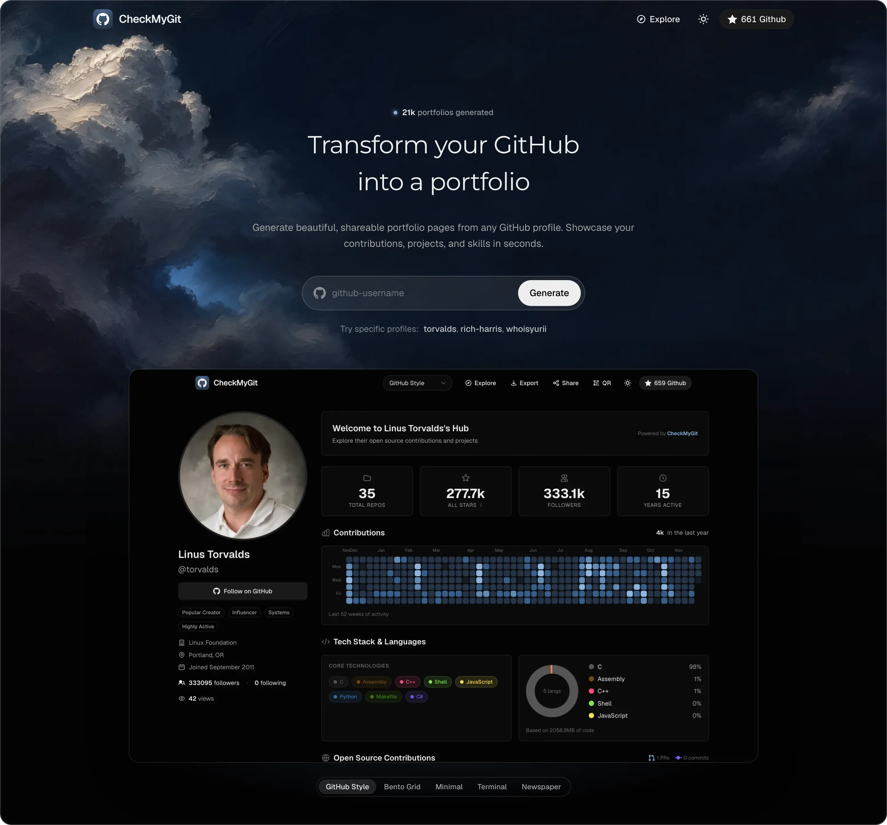
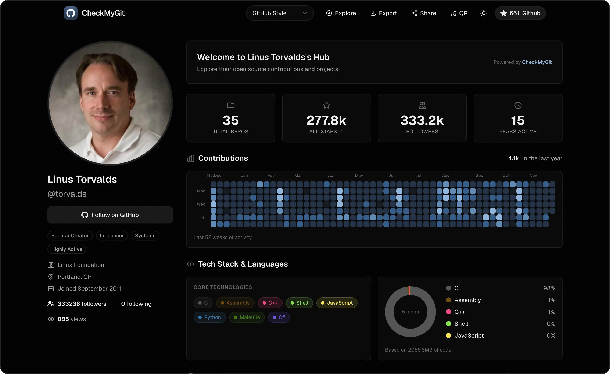
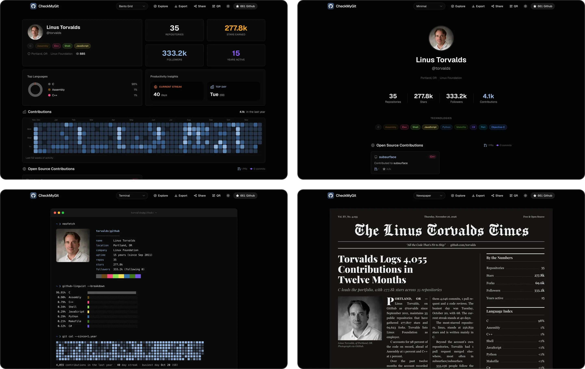

# CheckMyGit

CheckMyGit turns any public GitHub profile into a portfolio page. Enter a username at [checkmygit.com](https://checkmygit.com), choose a template and share the link. There is no account to create and nothing to configure.

<p align="center">
  <a href="https://checkmygit.com">
    <picture>
      <source media="(prefers-color-scheme: dark)" srcset=".github/readme/hero-dark.webp">
      <source media="(prefers-color-scheme: light)" srcset=".github/readme/hero-light.webp">
      
    </picture>
  </a>
</p>

## What you get

- **A portfolio for any public account** at `checkmygit.com/<username>`: profile and organizations, repository, star and follower counts, the last year of contributions, languages weighted by bytes of code, pinned projects, and pull requests and commits made to repositories the account does not own.
- **Five templates** that lay out the same data in different ways, each in a light and a dark theme.
- **Three ways to share it**: a link that keeps the chosen template, a QR code, and a PNG export of the portfolio.
- **Explore**: trending repositories by day, week or month; rankings of the most-starred repositories and most-followed developers; and a globe of up to 100 of the most-followed developers, where each marker opens that developer's portfolio.

## Templates

<p align="center">
  <picture>
    <source media="(prefers-color-scheme: dark)" srcset=".github/readme/portfolio-dark.webp">
    <source media="(prefers-color-scheme: light)" srcset=".github/readme/portfolio-light.webp">
    
  </picture>
</p>

| Template     | `?template=`       | Layout                                                                                                                       |
| ------------ | ------------------ | ---------------------------------------------------------------------------------------------------------------------------- |
| GitHub Style | `github` (default) | Profile sidebar beside stat cards, the contribution graph, a language chart and project cards (shown above)                  |
| Bento Grid   | `bento`            | A grid of cards, including the current streak and the most active weekday                                                    |
| Minimal      | `minimal`          | One centred column: name, four numbers, technologies, projects                                                               |
| Terminal     | `terminal`         | A terminal session with a `neofetch`-style summary, language bars, the contribution calendar and pinned repositories as `ls` |
| Newspaper    | `newspaper`        | A front page whose headline and article are written from the account's numbers                                               |

<p align="center">
  <picture>
    <source media="(prefers-color-scheme: dark)" srcset=".github/readme/templates-dark.webp">
    <source media="(prefers-color-scheme: light)" srcset=".github/readme/templates-light.webp">
    
  </picture>
</p>

The template is part of the URL (`checkmygit.com/torvalds?template=terminal`), so a shared link opens in the layout you picked. On screens narrower than 640 px a portfolio always uses GitHub Style.

## How it works

- **Profile data.** [`src/lib/server/github.ts`](src/lib/server/github.ts) loads a profile with one GitHub GraphQL query, authenticated with `GITHUB_TOKEN`. Without a token it falls back to the unauthenticated REST API, which has no contribution calendar or pinned items and a much lower rate limit. Profiles are fetched on every request and are not cached.
- **Rendering.** SvelteKit renders on the server and streams the profile: the page shell and a skeleton are sent at once, and the data fills in when GitHub answers. Every template is a Svelte component that receives the same `GitHubProfile` object.
- **Trending** is parsed from the HTML of `github.com/trending` and kept in the Cloudflare cache for one hour (daily), six hours (weekly) or a day (monthly). If parsing fails, a GraphQL search for the most-starred repositories is used instead.
- **Rankings** are GitHub GraphQL searches (`stars:>1000`, `followers:>1000`) and need the token.
- **Globe.** The most-followed users come from a GraphQL search. Their free-text locations are resolved to country centroids with a bundled table rather than a geocoding service, and the result is cached in KV for 24 hours. It is drawn with [cobe](https://github.com/shuding/cobe).
- **View counts** are stored in Cloudflare KV. A page reports its view from the browser after it loads, so crawlers are not counted, and a cookie keeps one visitor from being counted twice for the same profile within 24 hours.
- **Hosting.** Cloudflare Pages, through `@sveltejs/adapter-cloudflare`.

Built with SvelteKit 2, Svelte 5 runes, TypeScript and Tailwind CSS 4.

## Run it locally

You need Node.js 20.19+ or 22.12+ (the range Vite 7 supports).

```bash
git clone https://github.com/whoisyurii/checkmygit.git
cd checkmygit
npm install
cp .env.example .env   # then set GITHUB_TOKEN, or delete that line
npm run dev
```

The app is served at [localhost:5173](http://localhost:5173). No Cloudflare account is needed for local development.

`.env` holds one variable:

| Variable       | Required | Purpose                                                                                                                                |
| -------------- | -------- | -------------------------------------------------------------------------------------------------------------------------------------- |
| `GITHUB_TOKEN` | No       | A [personal access token](https://github.com/settings/tokens) with the `read:user` scope, used for the GraphQL queries described above |

Do not leave the placeholder value in place: it is sent to GitHub as it is, and every profile then fails with `GitHub API error: Unauthorized`.

Without a token the app still runs: profiles load over REST without the contribution graph or pinned projects, Rankings reports that the token is missing, and the globe shows a bundled sample set. Trending works either way.

| Command           | What it does                                                 |
| ----------------- | ------------------------------------------------------------ |
| `npm run build`   | Production build into `.svelte-kit/cloudflare`               |
| `npm run preview` | Serves the production build locally                          |
| `npm run check`   | Type-checks with `svelte-check`                              |
| `npm run lint`    | Runs the Prettier and ESLint checks                          |
| `npm run format`  | Formats the code with Prettier                               |
| `npm run deploy`  | Builds, then runs `wrangler pages deploy` (Cloudflare Pages) |

To deploy your own copy, create a KV namespace and put its id in [`wrangler.toml`](wrangler.toml) under the `PROFILE_VIEWS` binding in place of the committed one, and set `GITHUB_TOKEN` as an environment variable on the Pages project.

## Status and roadmap

The site is live and maintained. Since the first release it has gained light and dark themes, the Terminal and Newspaper templates, QR codes, organizations and the Explore section.

Not built yet:

- **Social preview images.** `/api/og/[username]` redirects to the account's GitHub avatar. A Satori and Resvg version was merged and then reverted ([#26](https://github.com/whoisyurii/checkmygit/pull/26), [#30](https://github.com/whoisyurii/checkmygit/pull/30)) because Cloudflare Workers blocks the runtime WASM compilation both libraries need.
- **PDF export.** Export is PNG only.
- **Custom accent colours and fonts.** Each template's palette and typefaces are fixed.

Open requests: saving the QR code to Apple Wallet or Google Wallet ([#39](https://github.com/whoisyurii/checkmygit/issues/39)) and showing a portfolio on the GitHub profile page itself ([#35](https://github.com/whoisyurii/checkmygit/issues/35)).

## Contributing

Issues and pull requests are welcome. Before opening a pull request, run `npm run check` and `npm run build`. Commit messages follow [Conventional Commits](https://www.conventionalcommits.org/) (`feat:`, `fix:`, `refactor:`).

To add a template, add its id and label to `TEMPLATES` in [`src/lib/types/portfolio.ts`](src/lib/types/portfolio.ts), create the component in `src/lib/components/templates/`, register it in `TEMPLATE_COMPONENTS` in `src/routes/[username]/+page.svelte`, and add light and dark captures to `src/lib/components/landing/template-screenshots.ts`. TypeScript reports an error until the last two are done.

## License

[MIT](LICENSE). Built by [@whoisyurii](https://github.com/whoisyurii).
